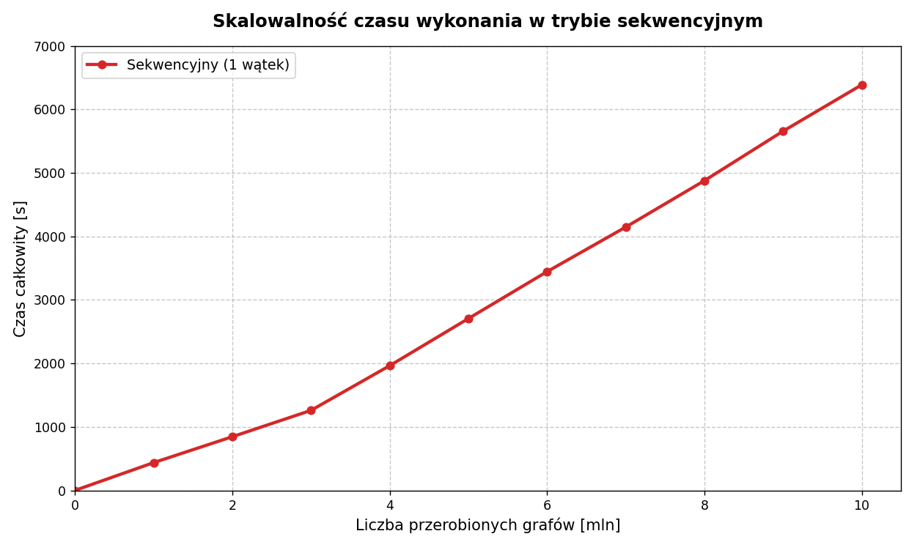
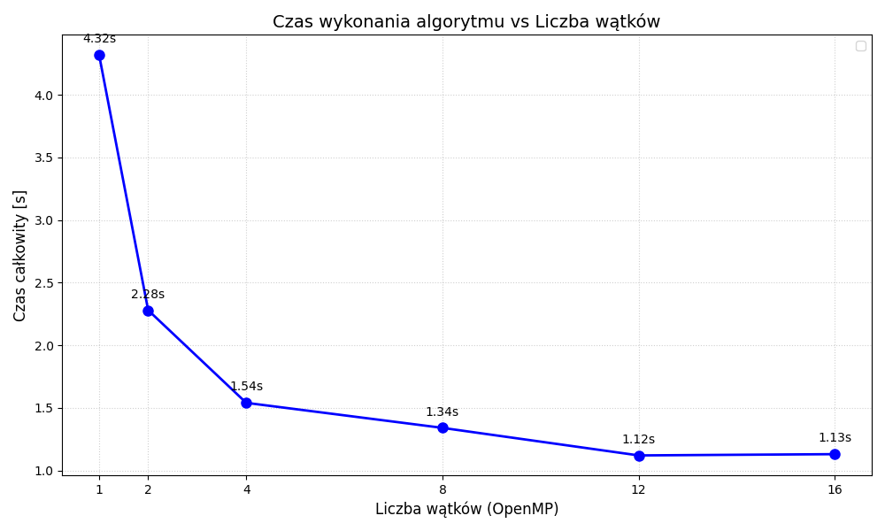
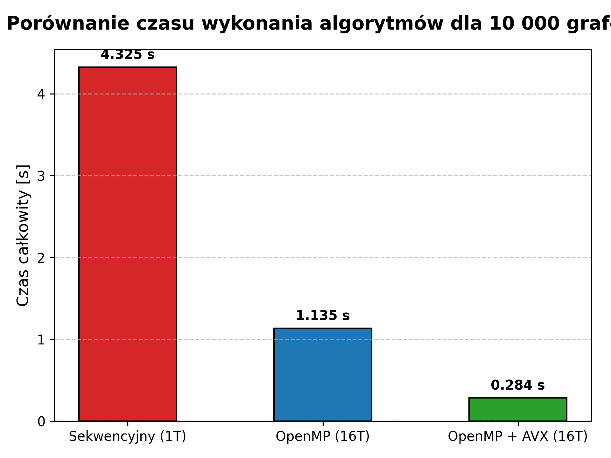
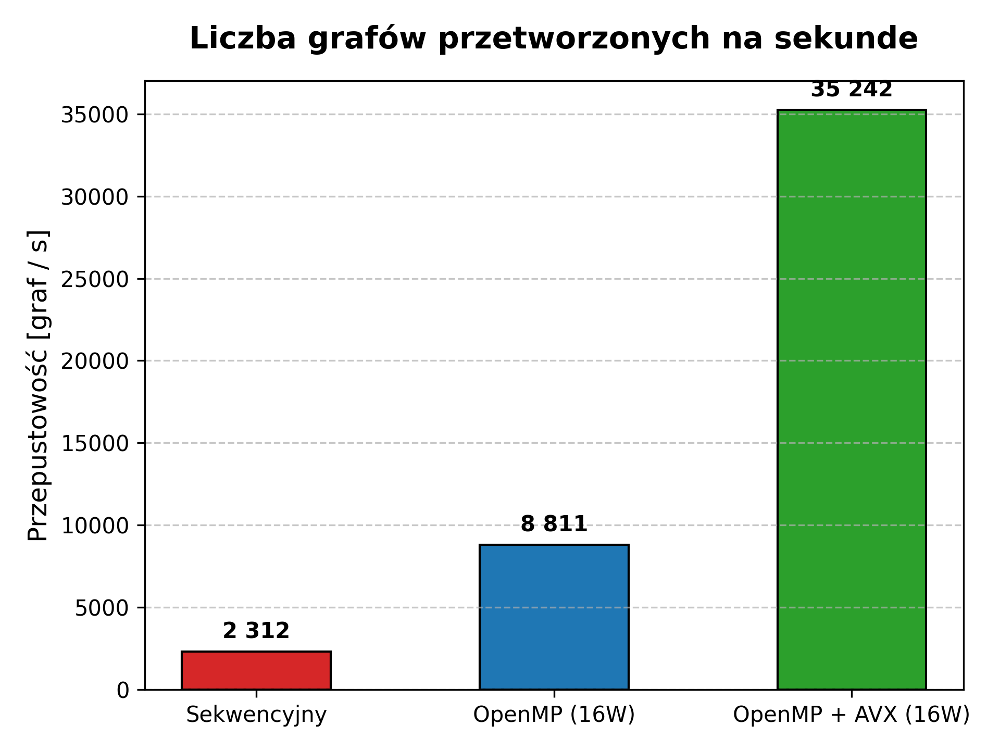
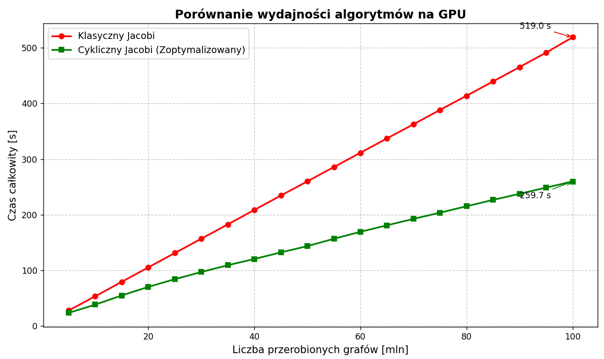
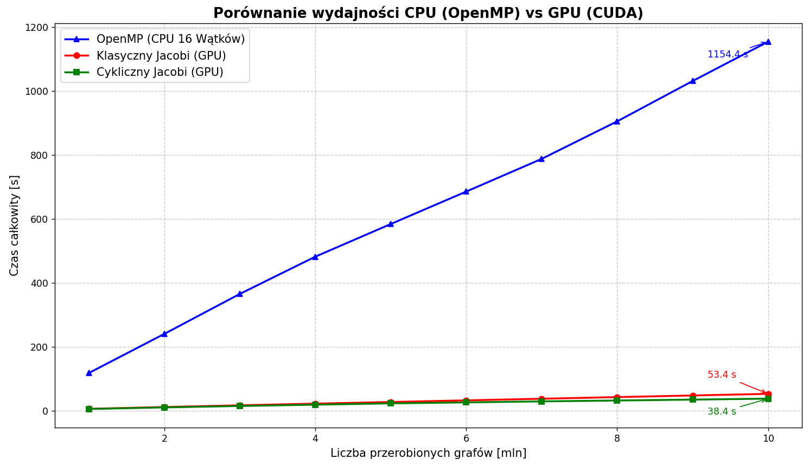
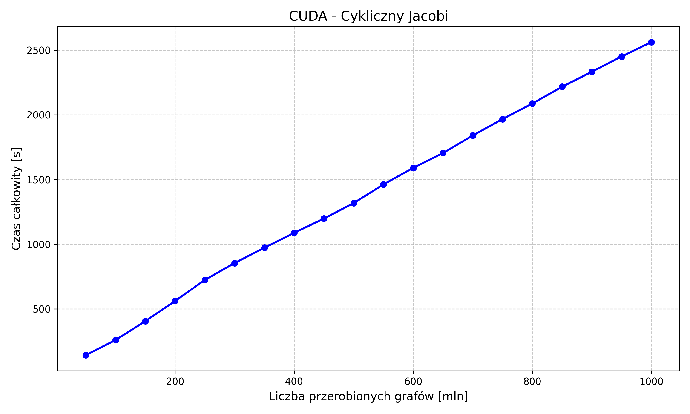

English | [Polski](README.pl.md)

# Integral Connected Graph Search ($N = 16$, $K = 85$)

A High-Performance Computing (HPC) and parallel programming project focused on searching for integral graphs and benchmarking five progressively optimized implementations across CPU and GPU architectures.

## Problem Description

The goal is to find [integral graphs](https://en.wikipedia.org/wiki/Integral_graph) — graphs for which all eigenvalues of the adjacency matrix are integers.

Connected graphs with $N = 16$ vertices and $K = 85$ edges are generated on the fly using `geng` from the [nauty](https://github.com/lonnen/nauty) package and verified by 5 implementations:

1. Sequential (CPU + Eigen) – `src/sequential.cpp`
2. OpenMP (CPU + Eigen) – `src/openmp.cpp`
3. OpenMP + AVX2 + FMA (CPU, Cyclic Jacobi) – `src/openmp_avx2.cpp`
4. CUDA – Classic Jacobi Algorithm (GPU) – `src/cuda_jacobi_classic.cu`
5. CUDA – Cyclic Jacobi Algorithm (GPU, Optimized) – `src/cuda_jacobi_cyclic.cu`

> Search Result: After checking over 1 billion connected graphs with 16 vertices and 85 edges, 0 integral graphs were found.

### Test Environment

* CPU: Intel Core i5-13500H (4 Performance cores / 8 HT threads + 8 Efficient cores)
* GPU: NVIDIA GeForce RTX 4050 Laptop GPU
* RAM: 16 GB
* Conditions: Laptop remained plugged in throughout all benchmarks.

## Build & Run (Linux / WSL)

### Prerequisites

```bash
sudo apt update
sudo apt install -y build-essential libeigen3-dev nauty
sudo ln -s $(which nauty-geng) /usr/local/bin/geng
```

*(For GPU versions, the NVIDIA CUDA Toolkit with `nvcc` is also required.)*

### Compilation & Execution

```bash
make                        # Build all 5 implementations into bin/
./bin/sequential            # 1. Sequential CPU
./bin/openmp                # 2. OpenMP CPU
./bin/openmp_avx2           # 3. OpenMP + AVX2 + FMA CPU
./bin/cuda_jacobi_classic   # 4. CUDA Classic Jacobi
./bin/cuda_jacobi_cyclic    # 5. CUDA Cyclic Jacobi
```

## 1. Sequential CPU (`src/sequential.cpp`)

The baseline implementation decodes the `graph6` string format into a symmetric $16 \times 16$ adjacency matrix and computes its eigenvalues using `Eigen::SelfAdjointEigenSolver`. Due to floating-point arithmetic, integrality is verified with a tolerance of $\epsilon = 10^{-7}$ (`std::abs(val - std::round(val)) > 1e-7`) to avoid falsely rejecting valid values such as `2.00000000000001`.



### Analysis & Findings

The chart shows sequential execution time (1 thread) for 10 million graphs. Around the 2–3 million mark, there is a clear inflection point in throughput:

* Initially, the OS scheduler assigned the process to a Performance core (P-Core).
* After sustained, monotonous single-threaded load, Windows power management migrated the thread to a slower, power-efficient Efficient core (E-Core) to reduce power draw and thermals.
* The P-Core proved to be roughly 1.75x faster than the E-Core. Visual Studio Diagnostic Tools (flat ~2 MB memory usage and constant single-thread CPU utilization) ruled out memory leaks or thread contention.

## 2. OpenMP – Multithreaded CPU (`src/openmp.cpp`)

The parallel CPU version uses `#pragma omp parallel for schedule(dynamic, 100)`. Dynamic scheduling with a chunk size of 100 graphs is essential for Intel's hybrid P/E-core architecture, preventing faster P-Cores from idling while waiting for slower E-Cores to finish their work.



### Analysis & Findings

* After 1h 46m on 16 threads (>90M graphs checked), no integral graph was found.
* Beyond 8 threads, gains on a small sample (10,000 graphs) flatten out (1.34 s at 8T vs 1.12 s at 12T and 1.13 s at 16T). Because the i5-13500H has 4 P-Cores (8 HT threads) and 8 E-Cores, scaling to 12–16 threads on a small batch introduces scheduling overhead and involves slower E-Cores, offsetting further speedup.

## 3. OpenMP + AVX2 + FMA (`src/openmp_avx2.cpp`)

Replacing Eigen with a custom vectorized Cyclic Jacobi solver dramatically improved CPU throughput through three low-level optimizations:

1. AVX2 Vectorization (`__m256d`): Packs 4 `double` values into 256-bit vector registers to process them in a single clock cycle (~4x baseline speedup).
2. Memory Alignment (`alignas(32)`): Aligns the $16 \times 16$ matrix buffer to 32-byte boundaries for optimal CPU cache-line access without split-load penalties.
3. FMA Instructions (`-mfma`): Fused Multiply-Add executes $A \times B + C$ as a single hardware instruction, shortening the critical path of the inner loop.

### CPU Implementations Comparison (10,000 graphs)





## 4. CUDA – Jacobi Eigenvalue Algorithm on GPU

The Jacobi algorithm is an iterative numerical method for computing eigenvalues of real symmetric matrices by applying orthogonal Givens rotations that systematically zero out off-diagonal elements. Once converged, the eigenvalues lie directly on the main diagonal.

In both CUDA implementations, batches of graphs are decoded into a flat host buffer and transferred to the GPU (`cudaMemcpy`). Each GPU thread copies its $16 \times 16$ matrix into local registers and checks integrality directly on the device — only a single 1-byte flag per graph is copied back over PCIe.

### 4.1 Classic Jacobi (`src/cuda_jacobi_classic.cu`)

On every iteration, each thread scans the entire upper triangle of the matrix in $O(N^2)$ time to locate the largest off-diagonal element to annihilate.

### 4.2 Cyclic Jacobi (`src/cuda_jacobi_cyclic.cu`)

Completely eliminates the maximum-search step. Instead, it sweeps systematically through all index pairs $(p, q)$ and applies a Givens rotation whenever $|a_{pq}| > 10^{-7}$.

### GPU Comparison: Classic vs Cyclic Jacobi (up to 100M graphs)



The cyclic variant cut the processing time for 100 million graphs from 519.0 s down to 259.7 s (~2x speedup). This comes from two key factors:

* Elimination of $O(N^2)$ search overhead: Compute cycles go straight into Givens rotations rather than scanning for maxima.
* Reduction of [warp divergence](https://modal.com/gpu-glossary/perf/warp-divergence): GPU threads execute in 32-thread warps in lockstep. The classic algorithm's `if (v > max_off)` branch inside the search loop caused threads within a warp to diverge constantly, forcing serialized execution. The cyclic sweep removes this bottleneck.

## 5. Overall Performance Comparison

### CPU (OpenMP 16T) vs GPU (CUDA) – up to 10M graphs



### Speedup Across All Implementations (Logarithmic Scale)


| Algorithm | Throughput [graphs/s] | Speedup (vs 1T P-Core) |
| --- | --- | --- |
| Sequential (1T E-Core) | 1,361 | 0.58x |
| Sequential (1T P-Core) | 2,365 | 1.00x |
| OpenMP (16T, Eigen) | 8,663 | 3.66x |
| CUDA – Classic Jacobi (GPU) | 192,678 | 81.47x |
| OpenMP + AVX2 + FMA (16T, CPU) | 288,126 | 121.83x |
| CUDA – Cyclic Jacobi (GPU) | 385,060 | 162.82x |

### Top 3 Implementations Scalability (up to 100M graphs)


### Long-Run Test: 1 Billion Graphs (CUDA Cyclic Jacobi)



## 6. Summary & Conclusions

* The single-threaded baseline was severely bottlenecked and suffered further degradation when the OS migrated the workload from a P-Core to an E-Core.
* Adding OpenMP provided a solid initial boost (~3.66x), but combining multithreading with AVX2 + FMA vectorization and a custom Jacobi solver unlocked a 121.83x speedup on CPU alone.
* Notably, the heavily optimized CPU implementation (347.1 s for 100M graphs) outperformed the naive Classic Jacobi GPU kernel (519.0 s), proving that poor memory access patterns and warp divergence can easily waste GPU potential.
* The Cyclic Jacobi CUDA implementation won decisively (259.7 s for 100M graphs, 162.82x speedup), scanning 1 billion graphs in ~42.7 minutes on a laptop RTX 4050.