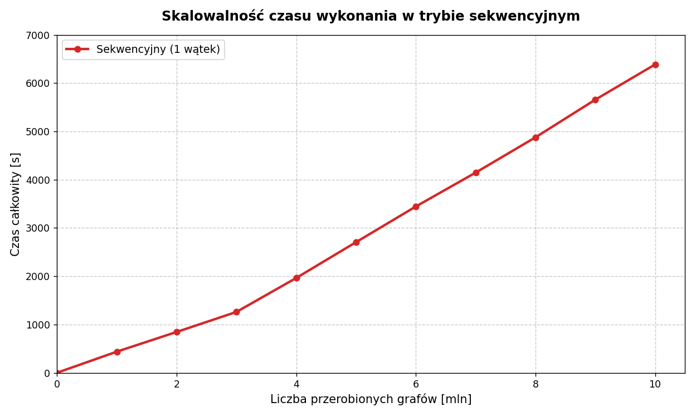
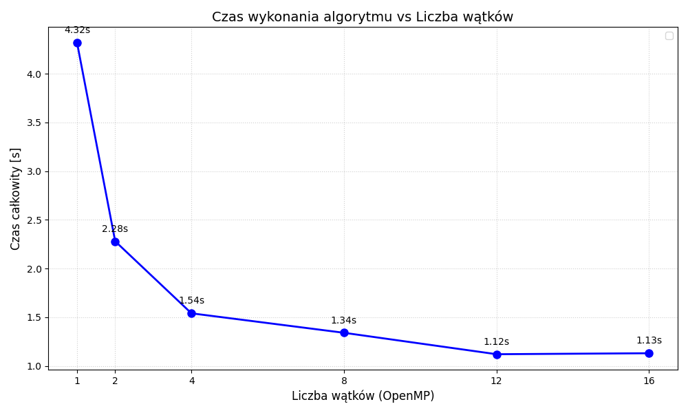
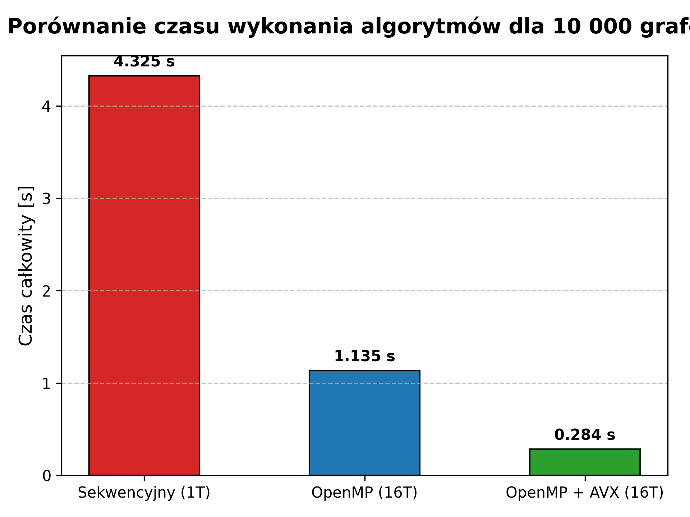
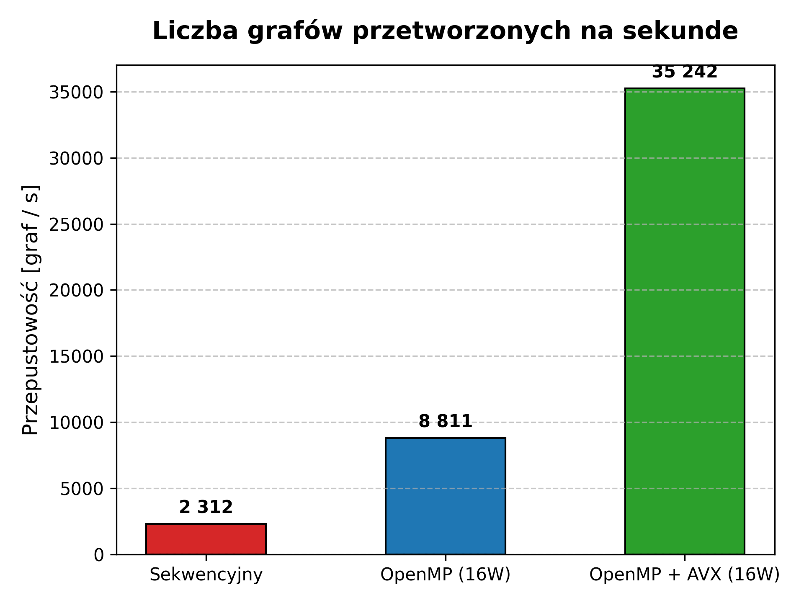
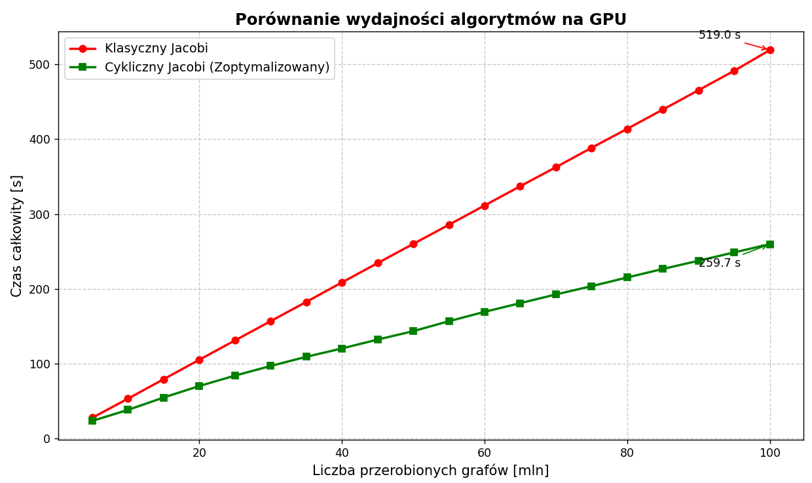
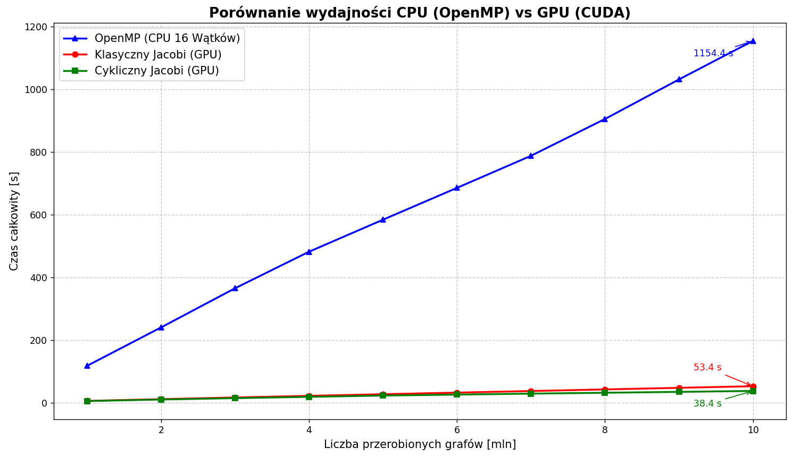
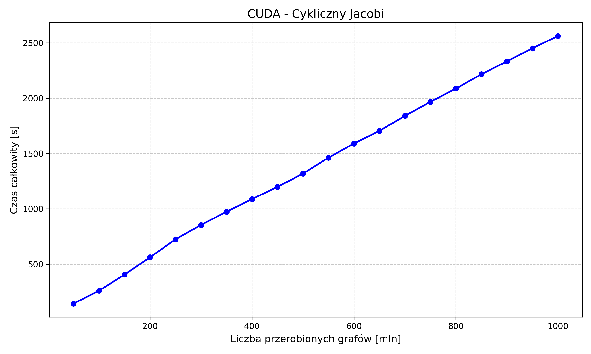

[English](README.md) | Polski

# Wyszukiwanie grafu spójnego całkowitego ($N = 16$, $K = 85$)

Projekt z zakresu programowania równoległego i obliczeń wysokiej wydajności (HPC), którego celem jest poszukiwanie grafów integralnych oraz analiza wydajności pięciu stopniowo optymalizowanych algorytmów na CPU i GPU.

## Opis problemu

Szukamy [grafów integralnych (Integral graph)](https://en.wikipedia.org/wiki/Integral_graph), czyli takich, w których wszystkie wartości własne macierzy sąsiedztwa wychodzą całkowite.

Grafy spójne o parametrach $N = 16$ wierzchołków oraz $K = 85$ krawędzi generowane są przez narzędzie `geng` z pakietu [nauty](https://github.com/lonnen/nauty), a następnie weryfikowane przez 5 implementacji:

1. Sekwencyjna (CPU + Eigen) – `src/sequential.cpp`
2. OpenMP (CPU + Eigen) – `src/openmp.cpp`
3. OpenMP + AVX2 + FMA (CPU, cykliczny Jacobi) – `src/openmp_avx2.cpp`
4. CUDA – Klasyczny algorytm Jacobiego (GPU) – `src/cuda_jacobi_classic.cu`
5. CUDA – Cykliczny algorytm Jacobiego (GPU, zoptymalizowany) – `src/cuda_jacobi_cyclic.cu`

Wynik poszukiwań: Po przeszukaniu ponad 1 miliarda grafów o 16 wierzchołkach i 85 krawędziach nie udało się znaleźć ani jednego grafu integralnego.

### Środowisko testowe

* Procesor: Intel Core i5-13500H (4 rdzenie Performance / 8 wątków HT + 8 rdzeni Efficient)
* Karta graficzna: NVIDIA GeForce RTX 4050 Laptop GPU
* Pamięć RAM: 16 GB
* Warunki testu: Laptop przez cały czas podłączony do zasilania.

## Kompilacja i uruchomienie (Linux / WSL)

### Wymagania

```bash
sudo apt update
sudo apt install -y build-essential libeigen3-dev nauty
sudo ln -s $(which nauty-geng) /usr/local/bin/geng
```

*(Dla wersji GPU wymagany jest dodatkowo zainstalowany NVIDIA CUDA Toolkit z kompilatorem `nvcc`.)*

### Budowanie i uruchamianie

```bash
make                        # Kompilacja wszystkich 5 algorytmów do katalogu bin/
./bin/sequential            # 1. Sekwencyjny CPU
./bin/openmp                # 2. OpenMP CPU
./bin/openmp_avx2           # 3. OpenMP + AVX2 + FMA CPU
./bin/cuda_jacobi_classic   # 4. CUDA Klasyczny Jacobi
./bin/cuda_jacobi_cyclic    # 5. CUDA Cykliczny Jacobi
```
Pliki maja hardcodowany limit testu w funkcji main. Defaultowo LIMIT_TESTU = 10000; MILESTONE_TESTU = 1000;


## 1. Sekwencyjnie na CPU (`src/sequential.cpp`)

Rozwiązanie bazowe dekoduje format `graph6` na symetryczną macierz sąsiedztwa $16 \times 16$ i wyznacza wartości własne za pomocą `Eigen::SelfAdjointEigenSolver`. Ze względu na arytmetykę zmiennoprzecinkową sprawdzanie całkowitości odbywa się z tolerancją $\epsilon = 10^{-7}$ (`std::abs(val - std::round(val)) > 1e-7`), aby uniknąć błędnego odrzucenia wyniku typu `2.00000000000001`.



### Analiza i wnioski

Wykres prezentuje czas wykonania w trybie sekwencyjnym (1 wątek) dla próby 10 milionów grafów. W okolicach 2–3 milionów przetworzonych grafów widoczne jest wyraźne załamanie tempa wzrostu:

* W początkowej fazie system operacyjny przypisał obliczenia do wydajnego rdzenia typu Performance (P-Core).
* Po dłuższym czasie monotonnego obciążenia jednego wątku mechanizmy systemu wymusiły migrację procesu na wolniejszy, energooszczędny rdzeń Efficient (E-Core) w celu redukcji zużycia energii i temperatury.
* Rdzeń P-Core okazał się ok. 1.75x szybszy od E-Core. Narzędzia diagnostyczne (stałe zużycie pamięci ~2 MB oraz stałe obciążenie jednego wątku CPU) wykluczyły wyciek pamięci oraz współdzielenie wątku z innymi procesami.

## 2. OpenMP – Równolegle na CPU (`src/openmp.cpp`)

Wersja wielowątkowa wykorzystuje dyrektywę `#pragma omp parallel for schedule(dynamic, 100)`. Dynamiczne dzielenie paczek na mniejsze porcje po 100 grafów jest kluczowe dla hybrydowej architektury procesora (rdzenie P i E) – szybsze rdzenie Performance nie muszą bezczynnie czekać na wolniejsze rdzenie Efficient.



### Analiza i wnioski

* Po 1h 46min pracy na 16 wątkach i przeszukaniu ponad 90 mln grafów nie znaleziono grafu integralnego.
* Powyżej 8 wątków przyrost wydajności dla małej próbki (10 000 grafów) staje się marginalny (1.34 s dla 8W vs 1.12 s dla 12W i 1.13 s dla 16W). Procesor i5-13500H ma 4 rdzenie P (8 wątków HT) oraz 8 rdzeni E – przy 12 i 16 wątkach i małej paczce danych narzut synchronizacji oraz włączenie wolniejszych rdzeni E niwelują dalszy zysk.

## 3. OpenMP + AVX2 + FMA (`src/openmp_avx2.cpp`)

Zastąpienie biblioteki Eigen własną implementacją cyklicznego algorytmu Jacobiego z ręczną wektoryzacją znacząco przyspieszyło obliczenia na CPU. Zastosowano trzy kluczowe optymalizacje:

1. Wektoryzacja AVX2 (`__m256d`): Ładowanie 4 liczb typu `double` do 256-bitowych rejestrów wektorowych i przetwarzanie ich w jednym cyklu zegara (~4x szybsze obliczenia bazowe).
2. Wyrównanie pamięci (`alignas(32)`): Dopasowanie tablicy macierzy $16 \times 16$ do granic linii cache procesora, eliminujące narzut odczytu rozproszonych danych.
3. Instrukcje FMA (`-mfma`): Fused Multiply-Add wykonuje operacje $A \times B + C$ w jednym rozkazie procesora, skracając ścieżkę krytyczną wewnętrznej pętli.

### Porównanie algorytmów na CPU (próba 10 000 grafów)





## 4. CUDA – Algorytm Jacobiego na GPU

Algorytm Jacobiego to iteracyjna metoda numeryczna wyznaczania wartości własnych rzeczywistych macierzy symetrycznych poprzez sekwencję ortogonalnych obrotów Givensa, które zerują elementy pozadiagonalne. Po osiągnięciu zbieżności wartości własne znajdują się na głównej przekątnej.

W obu wersjach CUDA paczki grafów dekodowane są do płaskiego bufora w pamięci RAM i przesyłane na GPU (`cudaMemcpy`). Każdy wątek GPU kopiuje jedną macierz $16 \times 16$ do lokalnych rejestrów i weryfikuje integralność bezpośrednio na karcie – przez magistralę PCIe wraca jedynie 1-bajtowa flaga wyniku na graf.

### 4.1 Klasyczny algorytm Jacobiego (`src/cuda_jacobi_classic.cu`)

W każdej iteracji przeszukuje cały górny trójkąt macierzy w czasie $O(N^2)$, aby znaleźć największy element pozadiagonalny do wyzerowania.

### 4.2 Cykliczny algorytm Jacobiego (`src/cuda_jacobi_cyclic.cu`)

Eliminuje całkowicie etap wyszukiwania maksimum. Zamiast tego przechodzi systematycznie po wszystkich parach indeksów $(p, q)$ i wykonuje obrót Givensa dla każdego elementu przekraczającego próg tolerancji $10^{-7}$.

### Porównanie wersji GPU (skala do 100 mln grafów)



Wersja cykliczna skróciła czas przetwarzania 100 milionów grafów z 519.0 s do 259.7 s (przyspieszenie ~2x). Wynika to z dwóch czynników:

* Eliminacja przeszukiwania $O(N^2)$: Cała moc obliczeniowa trafia w operacje matematyczne zamiast w szukanie maksimum.
* Redukcja [warp divergence](https://modal.com/gpu-glossary/perf/warp-divergence): Wątki na GPU wykonują instrukcje w grupach po 32 (warpy) w trybie lockstep. Wersja klasyczna posiadała warunek `if (v > max_off)` wewnątrz pętli szukającej, przez co wątki w warpie stale się rozchodziły i musiały być wykonywane szeregowo. Wersja cykliczna usuwa to wąskie gardło.

## 5. Porównanie wszystkich algorytmów

### CPU (OpenMP 16T) vs GPU (CUDA) – skala do 10 mln grafów



### Skok wydajnościowy wszystkich implementacji (skala logarytmiczna)


| Algorytm | Przepustowość [grafów/s] | Przyspieszenie (vs 1T P-Core) |
| --- | --- | --- |
| Sekwencyjny (1T E-Core) | 1 361 | 0.58x |
| Sekwencyjny (1T P-Core) | 2 365 | 1.00x |
| OpenMP (16T, Eigen) | 8 663 | 3.66x |
| CUDA – Klasyczny Jacobi (GPU) | 192 678 | 81.47x |
| OpenMP + AVX2 + FMA (16T, CPU) | 288 126 | 121.83x |
| CUDA – Cykliczny Jacobi (GPU) | 385 060 | 162.82x |

### Porównanie najszybszych rozwiązań (skala do 100 mln grafów)


### Test długodystansowy: 1 miliard grafów (CUDA Cykliczny Jacobi)



## 6. Podsumowanie i wnioski

Przeprowadzone badania pokazują, że wybór architektury oraz niskopoziomowa optymalizacja kodu mają decydujące znaczenie dla wydajności:

* Podejście sekwencyjne okazało się skrajnie nieefektywne, a jego wydajność dodatkowo spadała przez migrację wątku z rdzenia P-Core na E-Core.
* Zastosowanie OpenMP przyniosło zauważalną poprawę (~3.66x), ale dopiero połączenie wielowątkowości ze sprzętową wektoryzacją AVX2 + FMA i własnym solverem Jacobiego dało potężne przyspieszenie 121.83x względem bazy.
* Co istotne, dobrze zoptymalizowany kod na CPU (347.1 s dla 100 mln grafów) pokonał klasyczną implementację Jacobiego na GPU (519.0 s), która traciła wydajność przez przeszukiwanie $O(N^2)$ i zjawisko *warp divergence*.
* Absolutnym zwycięzcą został cykliczny Jacobi na GPU (259.7 s dla 100 mln grafów, przyspieszenie 162.82x), który pozwolił na przeskanowanie 1 miliarda grafów w ~42.7 minuty na laptopowym RTX 4050.
